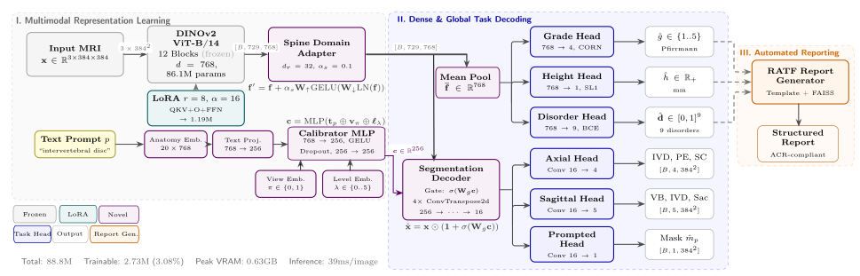
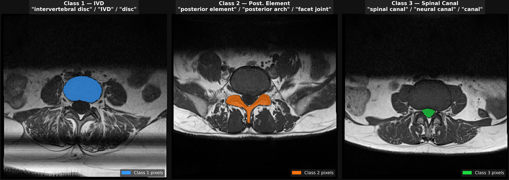
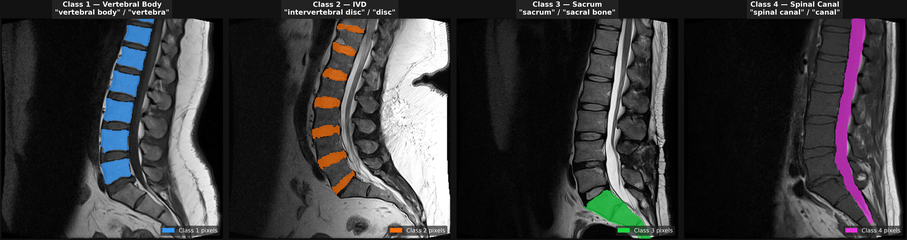
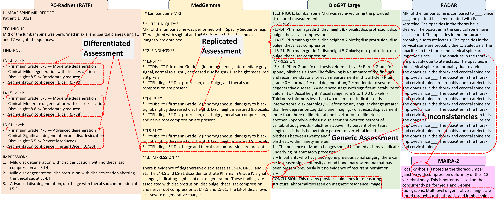
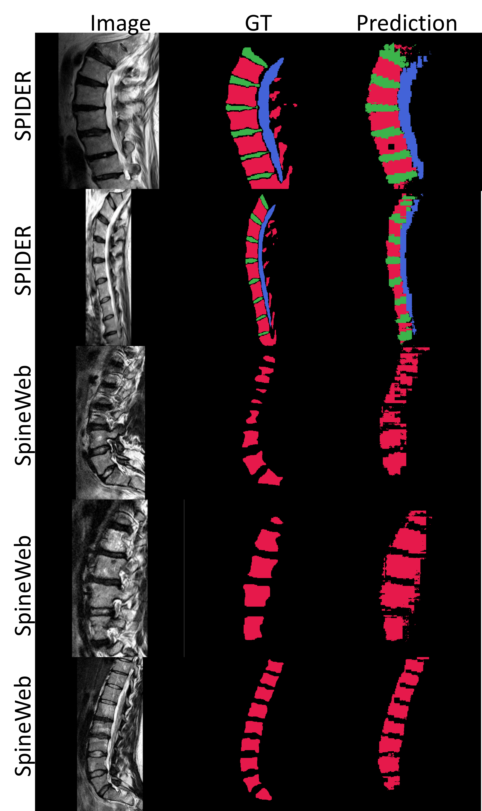

<div align="center">

# PC-RadNet

### Prompt-Calibrated, Parameter-Efficient Foundation Model for Comprehensive Multi-Task Segmentation, Clinical Assessment and Structured Report Generation in Lumbar Spine MRI

[](https://data.mendeley.com/datasets/p3r4xd2488/1)
[](LICENSE)
[](https://python.org)
[](https://pytorch.org)
[]()


</div>

---

Lumbar spine MRI interpretation requires concurrent anatomical segmentation, Pfirrmann disc degeneration grading, intervertebral disc height quantification, multi-label pathology detection and structured radiology report generation. These tasks have traditionally been addressed by separate resource-intensive architectures that require spatial annotations — bounding boxes or seed points — at inference time. **PC-RadNet** unifies all five tasks within a single parameter-efficient architecture, conditioned solely on free-text clinical prompts, and executes the full multi-task pipeline in **39 ms per image** at **0.63 GB peak VRAM** on a consumer GPU.

---

## Contents

1. [Method](#method)
2. [Results](#results)
3. [Qualitative Results](#qualitative-results)
4. [Installation](#installation)
5. [Dataset](#dataset)
6. [Quickstart — Inference](#quickstart--inference)
7. [Training](#training)
8. [Evaluation](#evaluation)
9. [Report Generation](#report-generation)
10. [Model Weights](#model-weights)
11. [Repository Structure](#repository-structure)
12. [Citation](#citation)

---

## Method

PC-RadNet is built on a frozen **DINOv2 ViT-B/14** (`vit_base_patch14_dinov2.lvd142m`) visual encoder — producing a sequence of 729 patch tokens ($d = 768$) from $384 \times 384$ RGB input — coupled with a four-stage ConvTranspose decoder that reconstructs dense segmentation predictions at full spatial resolution. Three lightweight trainable modules adapt the frozen representation to the radiological domain at a total parameter overhead of **3.07%** of backbone capacity:



### Spine Domain Adapter

A bottleneck residual adapter with rank $r = 32$ is applied to the post-encoder token sequence $\mathbf{F} \in \mathbb{R}^{B \times N \times d}$. A learnable scalar gate $s$ (initialised at $0.1$) controls the contribution magnitude at the onset of training, preventing large deviations from the pretrained representation:

$$\mathbf{F}^{\text{adapt}} = \mathbf{F} + s \cdot \mathbf{W}_{\text{up}} \cdot \phi\!\left(\mathbf{W}_{\text{down}} \cdot \mathrm{LN}(\mathbf{F})\right)$$

where $\mathbf{W}_{\text{down}} \in \mathbb{R}^{d \times r}$, $\mathbf{W}_{\text{up}} \in \mathbb{R}^{r \times d}$, and $\phi$ is GELU. Parameters: 51,489 (0.06% of backbone).

### Prompt Calibrator

A multi-conditional gate that maps free-text anatomy terms to a calibration feature $\mathbf{c} \in \mathbb{R}^{256}$, which multiplicatively modulates adapted ViT tokens prior to decoding. Given prompt $t$, imaging plane $p \in \{0, 1\}$ and disc level $\ell$:

$$\mathbf{c} = \mathrm{Calibrator}\!\left([\,\mathrm{TextProj}(\mathbf{E}_{\text{anat}}[t]);\; \mathbf{e}_p;\; \mathbf{e}_\ell\,]\right)$$

$$\mathbf{F}^* = \mathbf{F}^{\text{adapt}} \odot \bigl(1 + \sigma(\mathbf{W}_g\,\mathbf{c})\bigr)$$

where $\mathbf{E}_{\text{anat}} \in \mathbb{R}^{20 \times 768}$ is a trainable anatomy vocabulary embedding over a 20-term clinical lexicon projected to $\mathbb{R}^{256}$ via a two-layer MLP; $\mathbf{e}_p$ and $\mathbf{e}_\ell$ are learnable plane and level embeddings; and the additive formulation $(1 + \sigma(\cdot))$ preserves unadapted feature magnitudes throughout training. Parameters: 542,720.

The calibrator enables anatomy-specific segmentation from free-text prompts (e.g., *"intervertebral disc"*, *"spinal canal"*) without bounding boxes or seed points at inference.

### LoRA Encoder Adaptation

All linear projections within each of the 12 frozen DINOv2 ViT-B/14 transformer blocks are adapted via Low-Rank Adaptation with rank $r = 8$ and scaling coefficient $\alpha = 16$: the fused QKV projection ($\mathbf{W}_{\text{qkv}} \in \mathbb{R}^{768 \times 2304}$), output projection ($\mathbf{W}_{\text{proj}}$), and both MLP feed-forward layers ($\mathbf{W}_{\text{fc1}}$, $\mathbf{W}_{\text{fc2}}$).

$$\mathbf{W}' = \mathbf{W}_0 + \frac{\alpha}{r}\,\mathbf{B}\mathbf{A}, \quad \mathbf{A} \in \mathbb{R}^{r \times d_{\text{in}}},\; \mathbf{B} \in \mathbb{R}^{d_{\text{out}} \times r}$$

Total trainable LoRA parameters: 1,190,496 distributed across 49 adapted weight matrices — 48 within transformer blocks (4 per block × 12 blocks) plus the patch-embedding projection.

### Multi-Task Heads

All auxiliary prediction heads operate on the global average-pooled token sequence $\bar{\mathbf{f}} \in \mathbb{R}^{768}$ produced after domain adaptation.

| Head | Architecture | Output | Loss |
|---|---|---|---|
| Segmentation | 4-stage ConvTranspose decoder + plane-adaptive 1×1 conv | Prompted binary mask; axial 4-class / sagittal 5-class logits, 384×384 | Dice + class-weighted BCE |
| Grading | 3-layer MLP (768→256→64→4) + CORN | Pfirrmann grade $g \in \{1,\ldots,5\}$ via 4 cumulative thresholds | Ordinal cross-entropy + monotonicity penalty |
| Height | 2-layer MLP (768→128→1) | IVD height (px) | Smooth-L1 |
| Disorder | 2-layer MLP (768→256→9) | 9-label binary vector | BCE |

The segmentation decoder exposes three plane-specific output heads sharing a common four-stage ConvTranspose backbone: `axial_head` (4 classes: background, IVD, posterior element, spinal canal), `sag_head` (5 classes: background, vertebral body, IVD, sacrum, spinal canal) and `prompted_head` (binary mask of the queried anatomy term).

### Training Objective

$$\mathcal{L} = \mathcal{L}_{\text{seg}} + 0.5\,\mathcal{L}_{\text{grade}} + 0.3\,\mathcal{L}_{\text{height}} + 0.5\,\mathcal{L}_{\text{dis}} + 0.2\,\mathcal{L}_{\text{bnd}}$$

The boundary term $\mathcal{L}_{\text{bnd}}$ penalises contour deviation via MSE between Sobel-filtered predicted and ground-truth edge maps. Pfirrmann grading employs a CORN-style ordinal cross-entropy loss augmented with a monotonicity consistency penalty ($\lambda = 0.1$), enforcing the ordering constraint $P(g > k) \geq P(g > k+1)$ for $k \in \{1,\ldots,4\}$. Segmentation BCE is applied with per-class positive-weight terms derived from inverse class frequency.

### Parameter Efficiency

| Component | Parameters | Trainable |
|---|---|---|
| DINOv2 ViT-B/14 backbone (lvd142m) | 86.09 M | frozen |
| LoRA adapters (qkv, proj, fc1, fc2 × 12 blocks + patch embed, $r = 8$) | 1.19 M | ✓ |
| Spine Domain Adapter ($r = 32$) | 0.05 M | ✓ |
| Prompt Calibrator | 0.54 M | ✓ |
| Multi-task heads (seg + grade + height + disorder) | 0.95 M | ✓ |
| **Total trainable** | **2.73 M** | **3.08%** |

### RATF — Retrieval-Augmented Template Filling

Structured radiology reports are generated deterministically from PC-RadNet predictions via a two-stage pipeline:

1. **Template filling** — Per-level findings (grade, height, disorders, segmentation confidence) are mapped to RSNA-compliant report sentences via `GRADE_DESC` and `GRADE_CLINICAL` look-up tables.
2. **RAG retrieval (optional)** — A FAISS flat-IP index over 1,050 report embeddings (BiomedCLIP encoder) retrieves the three nearest patient reports; retrieved sentences augment the impression section.

---

## Results

### Ablation Study — Test Set, $n = 624$ images (78 patients)

| Variant | Description | Params | $\bar{D}$ | $\bar{J}$ | Grade Acc. (±1) | Height MAE | VRAM |
|---|---|---|---|---|---|---|---|
| A0 | Frozen backbone, no LoRA, no Calibrator | 1.00 M | 0.378 | 0.261 | 52.8% | — | 0.54 GB |
| A1 | SDA + LoRA encoder adaptation, no Calibrator | 2.19 M | 0.375 | 0.260 | 65.2% | — | 0.62 GB |
| **A2** | **Full PC-RadNet (SDA + LoRA + Prompt Calibrator)** | **2.73 M** | **0.861** | **0.770** | **92.3%** | **0.57 mm** | **0.63 GB** |
| A3 | PC-RadNet + SC-focused fine-tuning | 2.73 M | 0.871 | 0.785 | 91.6% | 0.55 mm | 0.63 GB |

$\bar{D}$: mean prompted Dice. $\bar{J}$: mean prompted IoU. Grade Acc. (±1): within-one-grade accuracy.

### Per-Class Segmentation — A2, Test Set

| Plane | Class | Dice | IoU | $n$ |
|---|---|---|---|---|
| Axial | IVD | 0.921 | 0.854 | 468 |
| Axial | Posterior Element | 0.849 | 0.737 | 468 |
| Axial | Spinal Canal | 0.883 | 0.791 | 468 |
| Sagittal | Vertebral Body | 0.901 | 0.820 | 156 |
| Sagittal | IVD (sagittal) | 0.878 | 0.782 | 156 |
| Sagittal | Sacrum | 0.815 | 0.689 | 156 |
| Sagittal | Spinal Canal (sag.) | 0.847 | 0.736 | 156 |

**Axial segmentation classes and prompt synonyms:**



**Sagittal segmentation classes and prompt synonyms:**



### Report Generation — 13-Method Benchmark, $n = 20$ matched patients

| Method | BLEU-1 | ROUGE-L | BERTScore $F_1$ | Factual $F_1$ |
|---|---|---|---|---|
| **PC-RadNet RATF (ours)** | **0.221** | **0.298** | **0.870** | **0.798** |
| Med-PaLM | 0.103 | 0.150 | 0.828 | 0.711 |
| Meditron3-8B | 0.060 | 0.106 | 0.813 | 0.699 |
| Llama-3.2-3B | 0.052 | 0.099 | 0.813 | 0.680 |
| BioMistral-7B | 0.097 | 0.134 | 0.827 | 0.655 |
| MedGemma | 0.044 | 0.088 | 0.824 | 0.621 |
| BioGPT-Large | 0.038 | 0.071 | 0.806 | 0.598 |
| RADAR | 0.031 | 0.059 | 0.791 | 0.542 |
| MAIRA-2 | 0.029 | 0.061 | 0.795 | 0.531 |

Full results including bootstrap confidence intervals, cross-dataset validation on SPIDER, RSNA 2024 and SpineWeb, and disorder-level F1 per pathology are in `results/quantitative/`.

---

## Qualitative Results

### Structured Report Generation — PC-RadNet RATF vs. LLM Baselines

The RATF module produces differentiated, patient-specific clinical findings at each disc level, whereas general-purpose LLMs exhibit replicated assessments across levels and factual inconsistencies.



### Zero-Shot External Validation — SPIDER and SpineWeb

Segmentation predictions on SPIDER (T1/T2 sagittal, 5-class) and SpineWeb (vertebral body, 1-class) demonstrate cross-institutional transfer of structural representations despite no domain-specific fine-tuning on external datasets.



---

## Installation

```bash
git clone https://github.com/raofarhatmasood/PC-RadNet.git
cd PC-RadNet

conda env create -f environment.yml
conda activate pc_radnet
```

**Requirements:** CUDA 12.1, Python 3.10, PyTorch ≥ 2.1. Tested on NVIDIA RTX 3060 (8 GB VRAM). CPU inference is supported but substantially slower.

---

## Dataset

PC-RadNet is trained and evaluated on **LSMA-PQR** — a multi-planar lumbar spine MRI dataset of 515 consecutive symptomatic patients.

| Property | Value |
|---|---|
| Patients | 515 |
| Images | 4,120 (384 × 384 px) |
| Acquisitions per patient | 8 (axial T1/T2 × 3 levels + sagittal T1/T2) |
| Segmentation classes | 7 (axial: IVD, PE, SC; sagittal: VB, IVD, Sacrum, SC) |
| Pfirrmann labels | 1,545 disc assessments (grades I–V) |
| IVD height labels | 1,545 measurements |
| Disorder labels | 9 categories, 515 patient-level reports |
| Train / Val / Test split | 360 / 77 / 78 patients (70/15/15%, grade-stratified) |

**Download:** [https://data.mendeley.com/datasets/p3r4xd2488/1](https://data.mendeley.com/datasets/p3r4xd2488/1)

After downloading, set `paths.dataset_root` in `configs/config.yaml` to the local dataset root. All derived paths (`images`, `labels`, `masks`, `metadata`) resolve relative to this root.

The `data/` directory in this repository contains only the patient-level split files (`train.txt`, `val.txt`, `test.txt`). Raw imaging data is not included.

---

## Quickstart — Inference

The fastest path to running PC-RadNet on a single image requires only the checkpoint and a clinical text prompt.

```python
import torch
import yaml
from pathlib import Path
from PIL import Image
import numpy as np
import sys

sys.path.insert(0, "scripts")
from train import PCRadNet, get_val_transforms

# ── Load config and model ────────────────────────────────────────────
with open("configs/config.yaml") as f:
    cfg = yaml.safe_load(f)

device = torch.device("cuda" if torch.cuda.is_available() else "cpu")

model = PCRadNet(cfg, use_calibrator=True, lora_rank=cfg["model"]["lora_rank"])
ckpt  = torch.load("checkpoints/best_by_mdice_A2.pt", map_location="cpu", weights_only=False)
model.load_state_dict(ckpt["model_state_dict"])
model = model.to(device).eval()

# ── Prepare input ────────────────────────────────────────────────────
transforms = get_val_transforms()
img  = np.array(Image.open("path/to/image.png").convert("RGB"))
data = transforms(image=img)
img_tensor  = data["image"].unsqueeze(0).to(device)        # (1, 3, 384, 384)
plane_id    = torch.tensor([0], device=device)             # 0 = axial, 1 = sagittal
prompt_text = ["intervertebral disc"]                      # any PROMPT_BANK entry

# ── Forward pass ─────────────────────────────────────────────────────
with torch.no_grad():
    outputs = model(img_tensor, prompt_text, plane_id)

pred_mask  = (torch.sigmoid(outputs["prompted_logits"][0, 0]) > 0.5).cpu().numpy()
pred_grade = outputs["grade_logits"].argmax(dim=-1).item() + 1   # 1-indexed
pred_height = outputs["height_pred"][0].item()
pred_disorders = (torch.sigmoid(outputs["disorder_logits"][0]) > 0.5).cpu().numpy()
```

**Available prompts per plane:**

```python
# Axial plane (plane_id = 0)
prompts_axial = ["intervertebral disc", "IVD", "disc",
                 "posterior element", "posterior arch", "facet joint",
                 "spinal canal", "neural canal", "canal"]

# Sagittal plane (plane_id = 1)
prompts_sagittal = ["vertebral body", "vertebra",
                    "intervertebral disc", "disc",
                    "sacrum", "sacral bone",
                    "spinal canal", "canal"]
```

---

## Training

Training follows a two-phase protocol. Phase 1 warms up the task heads with a high learning rate while the backbone remains frozen. Phase 2 fine-tunes all trainable modules with cosine-annealed learning rate and early stopping.

```bash
# Phase 1 — Head warm-up (5 epochs, lr = 1×10⁻⁴, batch size 2 × 8 grad-accum)
python scripts/train.py --phase=1

# Phase 2 — Full fine-tune, A2 variant (SDA + LoRA + Prompt Calibrator)
python scripts/train.py --phase=2 --ablation=A2

# Phase 2 — Full fine-tune, A3 variant (SDA + LoRA + Prompt Calibrator + SC fine-tuning)
python scripts/train.py --phase=2 --ablation=A3
```

**Hyperparameters (from `configs/config.yaml`):**

| Parameter | Phase 1 | Phase 2 |
|---|---|---|
| Epochs | 5 | ≤ 50 |
| Learning rate | $1 \times 10^{-4}$ | $5 \times 10^{-5}$ |
| Optimiser | AdamW ($\lambda = 0.01$) | AdamW ($\lambda = 0.01$) |
| Batch size | 2 | 2 |
| Gradient accumulation | 8 | 8 |
| LR schedule | constant | cosine annealing ($T_0 = 10$, $T_{\text{mult}} = 2$) |
| Early stopping | — | patience = 10 (monitor: $\bar{D}_\text{val}$) |
| Gradient clipping | 1.0 | 1.0 |
| Mixed precision | bfloat16 | bfloat16 |

Checkpoints are saved to `checkpoints/` as `best_by_mdice_{variant}.pt` (best validation Dice) and `best_by_miou_{variant}.pt` (best validation IoU). WandB logging is optional; set `wandb.entity` in `config.yaml` to enable.

---

## Evaluation

```bash
# Single checkpoint, test split
python scripts/evaluate.py --checkpoint best_by_mdice_A2.pt --split test

# All ablation variants with bootstrap confidence intervals and LaTeX tables
python scripts/evaluate.py --all-ablations --split test

# External zero-shot evaluation (SPIDER / SpineWeb)
python scripts/evaluate_external_v2.py --dataset spider --split test
python scripts/evaluate_external_v2.py --dataset spineweb --split test
```

Per-image results are written to `results/quantitative/test_{variant}_per_image.csv`. Summary metrics (JSON) and LaTeX tables are written to `results/quantitative/`.

```bash
# Compute 95% bootstrap confidence intervals (n=1000 resamples)
python scripts/compute_bootstrap_cis.py --results results/quantitative/test_A2_per_image.csv

# Statistical significance tests vs. baselines
python scripts/evaluate.py --statistical-tests --split test
```

---

## Report Generation

PC-RadNet supports two report generation modes. Template mode requires no additional VRAM beyond the segmentation model. RAG mode uses a FAISS flat-IP index over 1,050 training reports encoded with BiomedCLIP.

```bash
# Mode A — deterministic template filling
python scripts/generate_report.py --mode template \
    --predictions results/quantitative/test_A2_per_image.csv \
    --output-dir results/reports/

# Mode B — retrieval-augmented (build index first)
python scripts/generate_report.py --mode rag --build-index
python scripts/generate_report.py --mode rag \
    --predictions results/quantitative/test_A2_per_image.csv \
    --output-dir results/reports/

# Evaluate report quality against reference reports (NLG metrics + factual F1)
python scripts/evaluate_nlg.py \
    --predictions results/reports/ \
    --references data/LSMA-PQR/Report/ \
    --output results/quantitative/nlg_evaluation_results.csv

# Benchmark against 12 external LLMs
python scripts/benchmark_report_llms.py \
    --references data/LSMA-PQR/Report/ \
    --output results/quantitative/nlg_evaluation_comprehensive_summary.csv
```

---

## Model Weights

The best-performing checkpoint is **A2** (full PC-RadNet: Spine Domain Adapter + LoRA encoder adaptation + Prompt Calibrator), which achieves $\bar{D} = 0.861$, $\bar{J} = 0.770$ and 92.3% within-one-grade Pfirrmann accuracy on the held-out test set of 624 images.

Place downloaded checkpoints in the `checkpoints/` directory:

```
checkpoints/
├── best_by_mdice_A2.pt          ← recommended; best segmentation + grading balance
├── best_by_miou_A2.pt
├── best_by_mdice_A3.pt          ← highest Dice (0.871); full PC-RadNet + SC fine-tuning
├── best_by_miou_A3.pt
├── best_by_mdice_A1.pt          ← LoRA-only ablation variant
├── best_by_miou_A1.pt
├── best_by_mdice_A0.pt          ← frozen backbone baseline
├── best_by_miou_A0.pt
├── sc_enhanced_a3.pt            ← SC-focused fine-tuned A3 (axial spinal canal specialisation)
├── faiss_metadata.json          ← BiomedCLIP report embeddings index (RAG mode)
└── faiss_medcpt_metadata.json   ← MedCPT report embeddings index (RAG mode)
```

**Checkpoint contents:**

```python
ckpt = torch.load("checkpoints/best_by_mdice_A2.pt", map_location="cpu", weights_only=False)
# ckpt["model_state_dict"]   — PCRadNet state dict
# ckpt["epoch"]              — epoch at which checkpoint was saved
# ckpt["val_dice"]           — validation mean Dice at that epoch
# ckpt["val_iou"]            — validation mean IoU at that epoch
# ckpt["grade_acc"]          — within-one-grade Pfirrmann accuracy
# ckpt["height_mae"]         — IVD height mean absolute error (px)
# ckpt["trainable_params"]   — number of trainable parameters at training time
# ckpt["phase"]              — training phase (1 or 2)
# ckpt["ablation"]           — ablation variant identifier (A0–A3)
# ckpt["seed"]               — random seed used for training
```

**Loading for inference:**

```python
model = PCRadNet(cfg, use_calibrator=True, lora_rank=cfg["model"]["lora_rank"])
ckpt  = torch.load("checkpoints/best_by_mdice_A2.pt", map_location="cpu", weights_only=False)
model.load_state_dict(ckpt["model_state_dict"])
model.eval()
```

---

## Repository Structure

```
PC-RadNet/
├── assets/
│   ├── Architecture.png         # overall model architecture diagram
│   ├── ext.png                  # external validation figure
│   ├── fig_axial_classes.png    # axial segmentation classes
│   ├── fig_sagittal_classes.png # sagittal segmentation classes
│   └── Report_comparison.png   # RATF vs. LLM report comparison
├── configs/
│   └── config.yaml              # all hyperparameters, paths and dataset settings
├── data/
│   ├── README.md                # dataset description and access instructions
│   ├── train.txt                # 360 patient IDs
│   ├── val.txt                  # 77 patient IDs
│   └── test.txt                 # 78 patient IDs
├── notebooks/                   # exploratory / demo notebooks
├── scripts/
│   ├── train.py                 # PCRadNet model + SpineDataset + training loop
│   ├── evaluate.py              # per-class metrics, confusion matrices, LaTeX tables
│   ├── generate_report.py       # RATF template and RAG report generation
│   ├── visualize.py             # segmentation overlays and figure export
│   ├── generate_figures.py      # all manuscript figures
│   ├── baseline_zeroshot.py     # SAM / SAM2 zero-shot baselines
│   ├── evaluate_external.py     # cross-dataset evaluation v1
│   ├── evaluate_external_v2.py  # cross-dataset evaluation v2 (corrected preprocessing)
│   ├── benchmark_report_llms.py # 13-method NLG benchmark
│   ├── evaluate_nlg.py          # BLEU / ROUGE / BERTScore / factual F1
│   ├── improve_sc_segmentation.py
│   ├── disorder_analysis.py
│   ├── optimize_thresholds.py
│   ├── compute_bootstrap_cis.py
│   └── split_build.py
├── src/
│   └── pc_radnet/               # installable package (pip install -e .)
│       ├── __init__.py
│       ├── datasets/
│       ├── losses/
│       ├── models/
│       │   ├── pc_radnet_a2.pt  # A2 full model weights
│       │   └── pc_radnet_a3.pt  # A3 SC-fine-tuned weights
│       ├── report/
│       └── utils/
├── results/
│   ├── generated_reports/       # RATF output reports
│   ├── qualitative/             # saved segmentation overlays
│   └── quantitative/            # JSON / CSV metrics, LaTeX tables
├── environment.yml
└── LICENSE
```

---

## Citation

```bibtex
@article{masood2026pcradnet,
  title   = {{PC-RadNet}: A Prompt-Calibrated, Parameter-Efficient Foundation Model
             for Comprehensive Multi-Task Segmentation, Clinical Assessment and
             Report Generation in Spine {MRI}},
  author  = {Masood, Rao Farhat and Taj, Imtiaz Ahmad},
  journal = {TBD},
  year    = {2026},
  note    = {Under review}
}
```

---

## License

MIT License — see [LICENSE](LICENSE).
