<div align="center">

# PC-RadNet

### A Prompt-Calibrated, Parameter-Efficient Framework for Multi-Task Segmentation, Clinical Assessment and Report Generation in Lumbar Spine MRI

[-blue)](https://data.mendeley.com/datasets/p3r4xd2488/2)
[](LICENSE)
[](https://www.python.org)
[](https://pytorch.org)

</div>

This repository contains the code, configuration, data splits, stored predictions and analysis outputs for PC-RadNet. All tables and figures of the accompanying manuscript can be regenerated from it.

PC-RadNet adds 2.73 M trainable parameters to a frozen DINOv2 ViT-B/14 backbone. One forward pass returns a segmentation mask for a named anatomical structure, an ordinal Pfirrmann grade, a disc height estimate and probabilities for nine spinal disorders. A retrieval-augmented template filling (RATF) module then writes an RSNA-structured draft report from these predictions. Segmentation needs no bounding box or point: the target is selected by a term from a closed vocabulary of 13 anatomical terms, together with the imaging plane.

On the held-out LSMA-PQR test set (78 patients, 624 images), the model reaches:

| Output | Result |
|---|---|
| Prompted segmentation | mean Dice 0.861, mean IoU 0.769 |
| Pfirrmann grading | 61.8% exact accuracy, quadratic-weighted κ 0.51 |
| Disc height | MAE 1.51 mm |
| Disorders | patient-level macro-AUC 0.79 |
| RATF report | factual F1 0.711, every supplied finding kept, no unsupported content |
| Cost | 0.63 GB peak GPU memory; 39 ms per single-structure pass on an RTX 4070 Laptop GPU |

For segmentation alone, single-task networks trained on the same split are more accurate (2D U-Net 0.944, 2D SwinUNETR 0.937). PC-RadNet's advantage is that one model covers all five tasks.

---

## Contents

1. [Method](#method)
2. [Dataset](#dataset)
3. [Results](#results)
4. [Installation](#installation)
5. [Data and model files](#data-and-model-files)
6. [Reproducing the results](#reproducing-the-results)
7. [Where each reported number comes from](#where-each-reported-number-comes-from)
8. [Repository structure](#repository-structure)
9. [Citation](#citation)

---

## Method

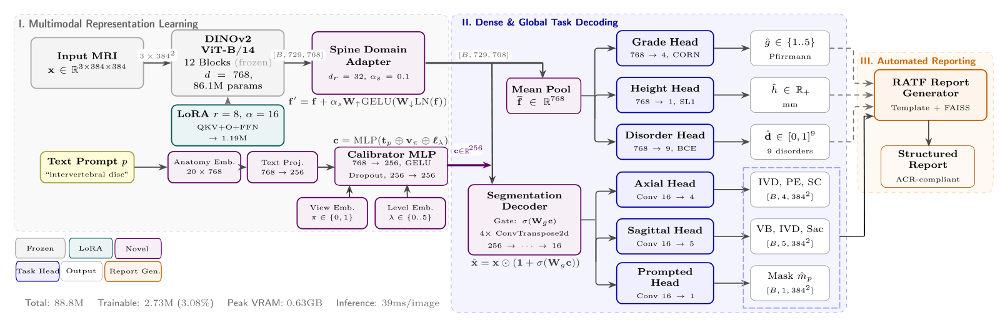

*Architecture. A frozen DINOv2 ViT-B/14 backbone with LoRA, the Spine Domain Adapter, the Prompt Calibrator that gates the decoder features, the segmentation decoder, the clinical heads on mean-pooled features, and the RATF report generator.*

### Backbone with LoRA

- **Input and tokens:** a 384 × 384 image gives 27 × 27 = 729 tokens of dimension 768 (`vit_base_patch14_dinov2.lvd142m` from `timm`).
- **Adapted layers:** LoRA (r = 8, α = 16, dropout 0.05) is applied to the fused QKV projection, the output projection and both feed-forward layers of all 12 blocks.
- **LoRA size:** 1.18 M trainable parameters.

### Spine Domain Adapter

A residual bottleneck applied to the encoder tokens:

f_spine = f + α_s · W_up · GELU(W_down · LN(f))

- **Rank and scaling:** rank 32; α_s is learnable and starts at 0.1.
- **Initialization:** W_up starts at zero, so the adapter begins as an identity mapping.
- **Size:** 51,489 parameters.

### Prompt Calibrator

**Inputs:**
- The anatomy term selects an entry of a learnable embedding table (20 entries, of which 13 are indexed by the prompt bank).
- A two-layer MLP projects that entry to 256 dimensions.
- It is concatenated with a plane embedding and a level embedding. In the reported model, the level embedding receives a constant index and acts as a learned bias.

**Gate:** a fusion MLP (768 → 256 → 256) produces the calibration vector c. Projected tokens are then scaled channel-wise:

û_i = u_i ⊙ (1 + σ(W_g c))

Every scaling factor lies in (1, 2). Appendix B of the manuscript states the capacity result for this joint gate.

### Heads and loss

| Head | Architecture | Output |
|---|---|---|
| Segmentation decoder | 4 ConvTranspose stages (256 → 16 channels), then 1×1 heads | axial 4-class and sagittal 5-class logits, prompted binary mask |
| Grade | MLP 768 → 256 → 64, 4 cumulative logits P(Y > k) | Pfirrmann grade 1 to 5 |
| Height | MLP 768 → 128 → 1 | disc height (mm) |
| Disorders | MLP 768 → 256 → 9, sigmoid | 9 binary findings |

**Loss:** L = λs·L_seg + λp·L_prompt + λb·L_bound + λg·L_grade + λh·L_ht + λd·L_dis.

- **Weights:** (λs, λp, λb, λg, λh, λd) = (1.0, 1.0, 0.2, 0.5, 0.3, 0.5).
- **Segmentation losses:** class-balanced BCE plus soft Dice. Inverse-frequency `pos_weight` per class; the axial spinal canal gets w_SC = 90.0.
- **Boundary loss:** MSE between Sobel gradient magnitudes of the predicted and reference masks.
- **Grading loss:** cumulative ordinal BCE with a monotonicity penalty (weight 0.1).

### RATF report generator

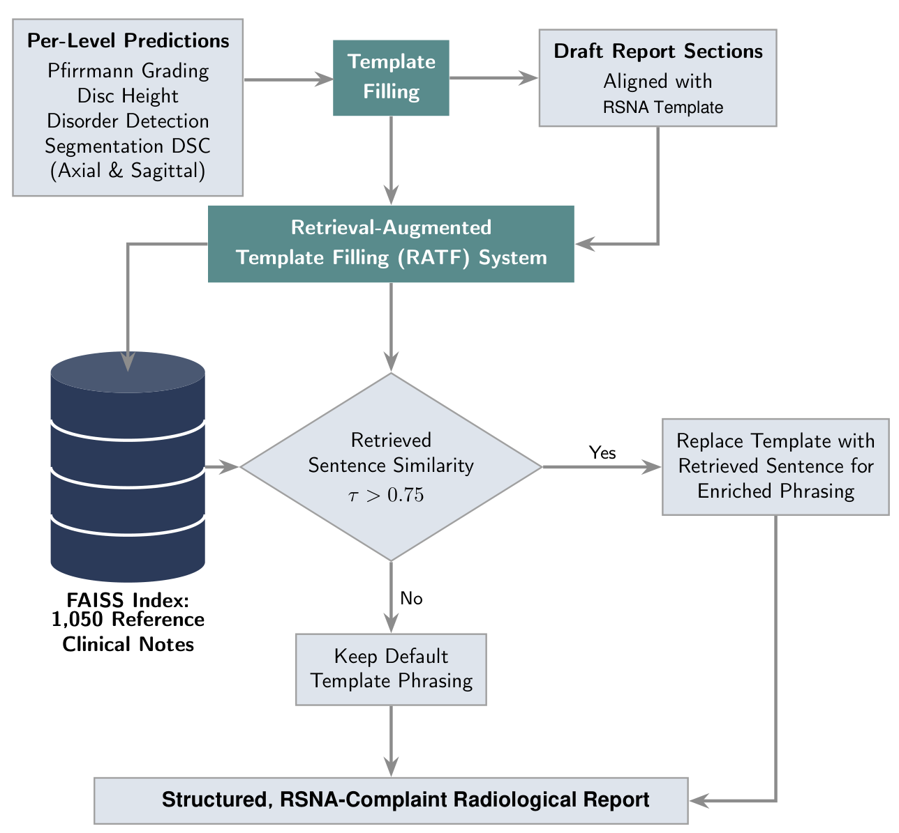

1. **Template:** a deterministic template writes one RSNA-structured finding sentence per disc level (L3-L4, L4-L5, L5-S1). It uses the predicted grade, the disorders with probability > 0.5, and the height in mm.
2. **Retrieval index:** a FAISS index holds 436 unique sentences from the radiologist reports of the 360 training patients. Sentences are embedded with `all-MiniLM-L6-v2`.
3. **Slot check:** a retrieved sentence replaces the template sentence only if three conditions hold:
   - its cosine similarity exceeds τ = 0.75;
   - it names the same disc level and the same finding set;
   - it negates none of these findings.
4. **Impression:** this section is compiled directly from the predictions and is never replaced.

---

## Dataset

The model is trained and evaluated on **LSMA-PQR**: 515 consecutive symptomatic patients with 4,120 multi-planar lumbar MRI images (384 × 384).

**Images per patient (eight):**
- axial T1w and T2w slices at L3-L4, L4-L5 and L5-S1 (six images);
- one mid-sagittal T1w and one mid-sagittal T2w slice.

**Annotations:**
- masks for seven structures: axial IVD, posterior elements and spinal canal; sagittal vertebral body, IVD, sacrum and spinal canal;
- Pfirrmann grades and disc heights (mm) for 1,545 discs;
- 515 structured reports with nine binary disorder labels.

| | Train | Val | Test |
|---|---|---|---|
| Patients | 360 | 77 | 78 |
| Images | 2,880 | 616 | 624 |
| Axial / Sagittal | 2,160 / 720 | 462 / 154 | 468 / 156 |
| Grade I / II / III / IV / V (axial images) | 36 / 1,164 / 514 / 386 / 60 | 8 / 264 / 108 / 72 / 10 | 2 / 238 / 130 / 90 / 8 |

- **Splits:** patient-level and stratified by each patient's maximum Pfirrmann grade. They are listed in [`data/`](data/).
- **Test split:** never used for model selection, early stopping or threshold tuning.
- **Download:** [Mendeley Data](https://data.mendeley.com/datasets/p3r4xd2488/2). See [`data/README.md`](data/README.md).

---

## Results

Unless stated otherwise, the values below are on the LSMA-PQR test set (624 images, 78 patients). Brackets give 95% confidence intervals from patient-level cluster bootstrap.

### Ablation

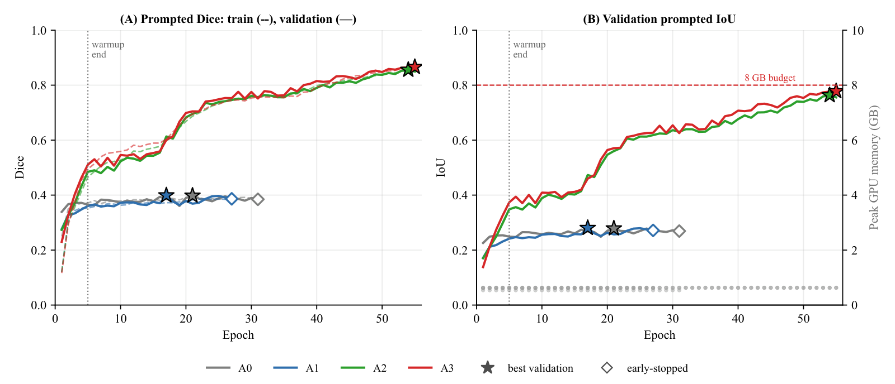

**Variants:**
- **A0:** frozen backbone, untrained calibrator.
- **A1:** adds LoRA.
- **A2:** the full model.
- **A3:** A2 with boundary-loss weight 1.0.
- **A2-SDA:** A2 without the Spine Domain Adapter.

The lower block of the table uses 15-epoch runs (5 + 10 epochs); compare rows only within that block.

| Variant | Params | Dice | IoU | MC-sel. | Grade acc. | κw | Height MAE (mm) | AUC |
|---|---|---|---|---|---|---|---|---|
| A0 | 1.00M | 0.389 [0.372, 0.406] | 0.270 | 0.611 | 0.528 | 0.31 | 1.70 | 0.73 |
| A1 | 2.19M | 0.383 [0.365, 0.400] | 0.266 | 0.673 | 0.652 | 0.61 | 1.58 | 0.81 |
| **A2** | 2.73M | **0.861 [0.853, 0.869]** | 0.769 | 0.849 | 0.618 | 0.51 | 1.51 | 0.79 |
| A3 | 2.73M | 0.872 [0.865, 0.879] | 0.785 | 0.857 | 0.583 | 0.53 | 1.59 | 0.81 |
| A2-SDA | 2.68M | 0.870 [0.862, 0.878] | 0.783 | 0.847 | 0.585 | 0.54 | 1.53 | 0.80 |
| *15-epoch runs* | | | | | | | | |
| A2 (seed 42) | 2.73M | 0.563 [0.545, 0.580] | 0.427 | 0.686 | 0.615 | 0.58 | 1.57 | 0.77 |
| A2 (seed 7) | 2.73M | 0.790 [0.781, 0.799] | 0.668 | 0.597 | 0.628 | 0.59 | 1.53 | 0.79 |
| A2-anat | 2.73M | 0.588 [0.571, 0.605] | 0.451 | 0.697 | 0.596 | 0.54 | 1.50 | 0.77 |
| A2-simple | 2.20M | 0.490 [0.473, 0.507] | 0.356 | 0.664 | 0.630 | 0.63 | 1.51 | 0.79 |
| A2-seg | 2.73M | 0.745 [0.732, 0.758] | 0.632 | 0.763 | - | - | - | - |

**Columns:**
- **MC-sel.:** Dice of the queried class read from the multi-class head.
- **AUC:** patient-level disorder macro-AUC.

**Findings:**
- **Calibrator vs. multi-class baseline:** on the same 2,026 image-class pairs, the trained calibrator adds 0.189 Dice [0.185, 0.193] over multi-class output selection.
- **Seed dependence:** in the 15-epoch runs, the epoch at which prompted Dice rises depends on the seed (figure below). This seed-to-seed spread is larger than the differences between the short-run variants.

<p align="center">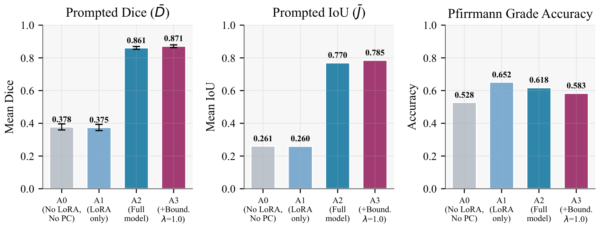</p>
<p align="center">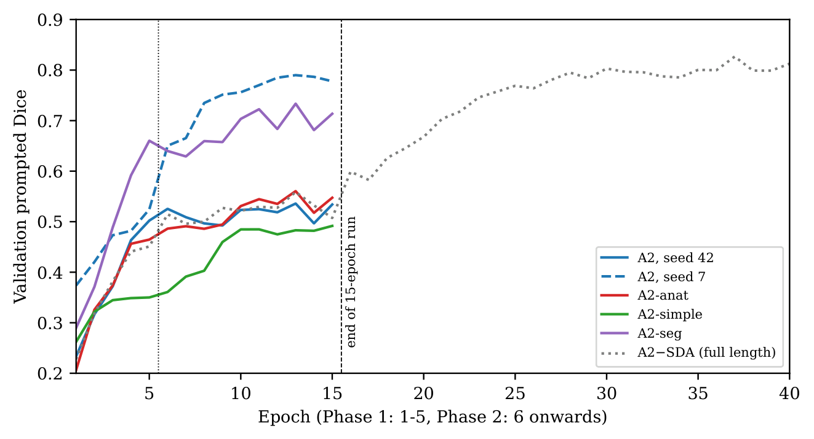</p>

### Segmentation

| Method | Dice | IoU | Trainable | GT box at inference | Multi-task | Time |
|---|---|---|---|---|---|---|
| 2D U-Net (PlainConvUNet), same split | 0.944 [0.939, 0.949] | 0.899 | 32.5M | No | No | 0.007 s |
| 2D SwinUNETR, same split | 0.937 [0.931, 0.941] | 0.886 | 6.3M | No | No | 0.025 s |
| SAM ViT-B, frozen encoder + trained decoder | 0.914 [0.907, 0.921] | 0.850 | 0.66M | No | No | 0.175 s |
| SAM ViT-B automatic masks, no fine-tuning | 0.456 [0.443, 0.469] | 0.391 | 0 | No | No | 3.19 s |
| MedSAM-2 (box prompt), no fine-tuning | 0.736 [0.729, 0.743] | 0.639 | 0 | Yes | No | 0.011 s |
| SAM ViT-B (box prompt), no fine-tuning | 0.810 [0.804, 0.816] | 0.711 | 0 | Yes | No | 0.15 s |
| **PC-RadNet (A2), prompted head** | 0.862 [0.856, 0.867] | 0.770 | 2.73M | No | Yes | 0.039 s |
| PC-RadNet (A2), multi-class head | 0.849 [0.843, 0.854] | 0.751 | 2.73M | No | Yes | 0.039 s |

- **Scope:** all rows use all 2,028 test image-class pairs. PC-RadNet skips two canal annotations of at most 100 pixels, leaving 2,026 pairs.
- **Timing hardware:** an RTX 4070 Laptop GPU.

**Per-class Dice (multi-class head):**

| Variant | IVD | PE | SC | VB | IVD (sag) | Sacrum | SC (sag) |
|---|---|---|---|---|---|---|---|
| A2 | 0.948 | 0.839 | 0.491 | 0.899 | 0.824 | 0.892 | 0.886 |
| A3 | 0.948 | 0.853 | 0.527 | 0.848 | 0.850 | 0.901 | 0.884 |
| A3 + axial canal fine-tune | 0.955 | 0.871 | 0.787 | - | - | - | - |

**Axial spinal canal (SC):**
- **Prompted head:** queried with the canal term, it reaches 0.734 on the 466 axial slices whose canal annotation exceeds 100 pixels.
- **Fine-tuned A3:** a separate canal-focused fine-tune of A3 raises canal Dice from 0.527 to 0.787.

<p align="center">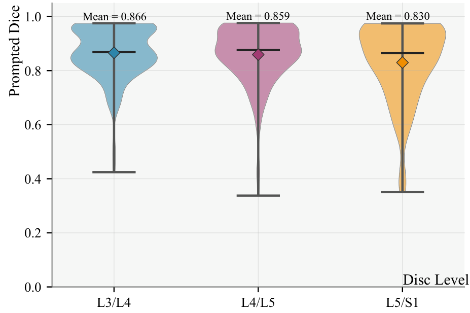 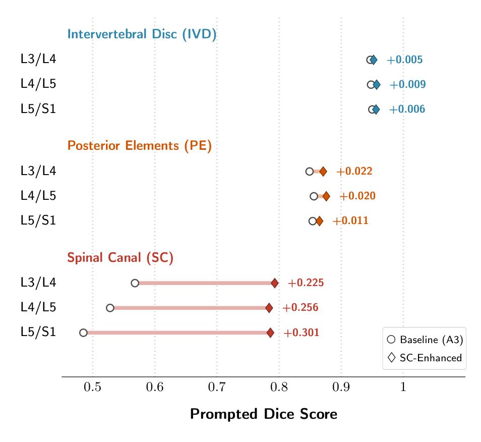</p>
<p align="center">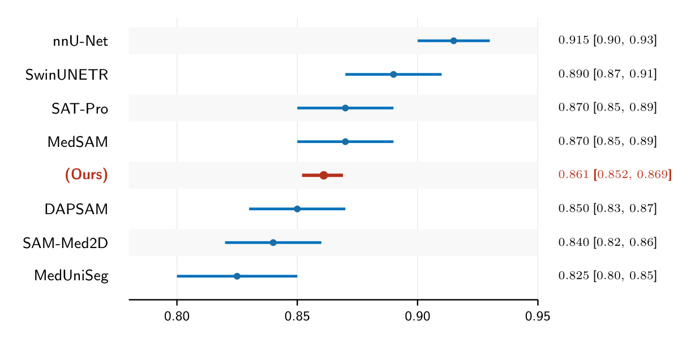</p>

### Clinical outputs

**Pfirrmann grading.** 468 axial images (234 discs).

| Statistic | A2 | Always Grade II | Always Grade III |
|---|---|---|---|
| Exact accuracy | 0.618 [0.549, 0.686] | 0.509 | 0.278 |
| MAE (grades) | 0.462 [0.374, 0.549] | 0.718 | 0.744 |
| Quadratic-weighted κ | 0.506 [0.383, 0.610] | 0 | 0 |
| Within ±1 accuracy | 0.923 [0.891, 0.951] | 0.791 | 0.979 |

- **Within ±1 accuracy:** not used for ranking, because always predicting Grade III scores higher on it than the model.
- **Radiologist agreement:** published inter-observer agreement is κ 0.69 to 0.81 and κw 0.83.

<p align="center">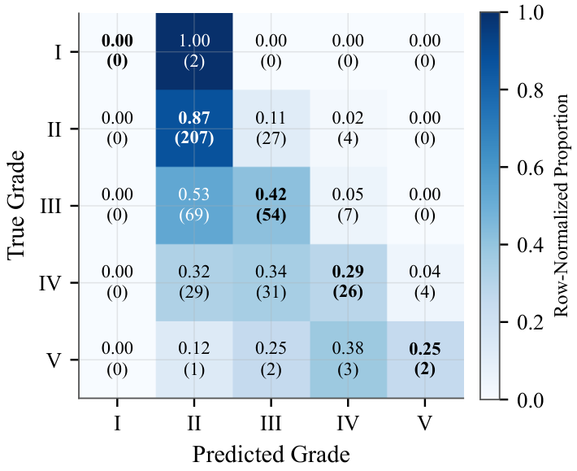 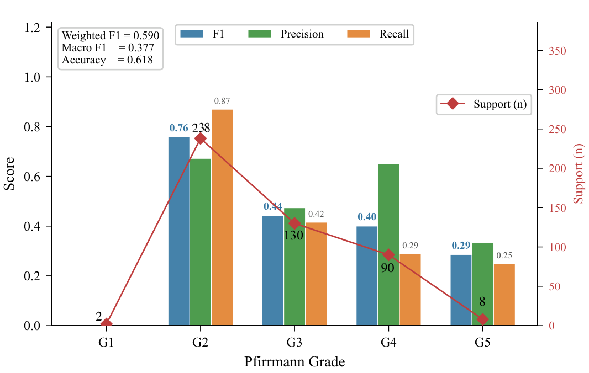</p>

**Disc height.** 234 T2w axial slices.

| Statistic | Value |
|---|---|
| MAE | 1.51 mm [1.33, 1.71] |
| Bias | +0.05 mm |
| 95% limits of agreement | [−3.87, +3.97] mm |
| Pearson r / Lin's CCC / ICC(A,1) | 0.54 / 0.50 / 0.50 |
| Constant predictor (training mean) | MAE 1.87 mm |

<p align="center">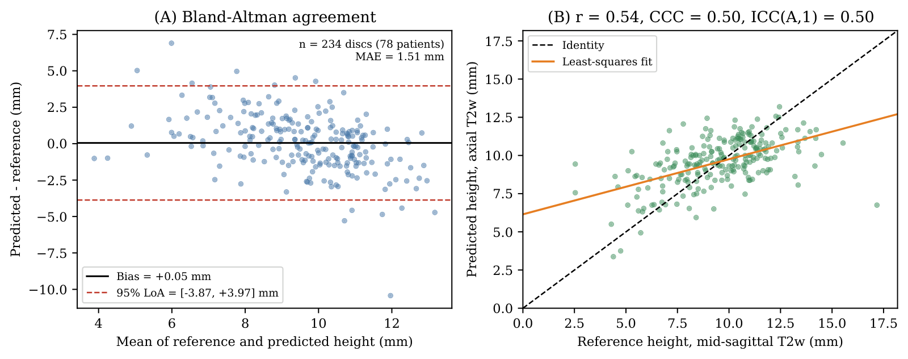</p>

**Disorders.** Thresholds are tuned on validation data.

| Level | Macro F1 | Always-positive F1 | Macro ROC-AUC |
|---|---|---|---|
| Per image | 0.34 (0.50 with tuned thresholds) | - | - |
| Per patient (78) | 0.46 | 0.40 | 0.79 |

### Report generation

The benchmark uses 20 matched test patients. Every system receives the same A2 predictions, and all reports are scored by one negation-aware finding extractor.

| Method | ROUGE-L | BERTScore | Factual F1 | All findings kept | Unsupported findings | Unsupported technique |
|---|---|---|---|---|---|---|
| **RATF, slot-checked retrieval (ours)** | 0.160 | 0.836 | 0.711 | 1.00 | 0.00 | 0.00 |
| RATF, template stage only | 0.142 | 0.827 | 0.711 | 1.00 | 0.00 | 0.00 |
| RATF, unrestricted retrieval (τ = 0.75) | 0.187 | 0.845 | 0.711 | 0.85 | 0.00 | 0.00 |
| Phi-3.5-mini | 0.112 | 0.819 | 0.714 | 0.50 | 0.05 | 1.00 |
| Med-PaLM (randomly initialized re-implementation) | 0.150 | 0.828 | 0.711 | 1.00 | 0.00 | 0.00 |
| Meditron3-8B | 0.106 | 0.813 | 0.699 | 0.95 | 0.00 | 0.85 |
| BioMistral-7B | 0.134 | 0.827 | 0.684 | 1.00 | 0.00 | 0.00 |
| Llama-3.2-3B-Instruct | 0.099 | 0.813 | 0.680 | 0.95 | 0.05 | 1.00 |
| MedGemma-4B-IT | 0.086 | 0.794 | 0.652 | 0.85 | 0.45 | 0.45 |
| BioGPT-Large | 0.094 | 0.810 | 0.628 | 1.00 | 0.00 | 0.00 |
| Qwen2.5-1.5B-Instruct | 0.138 | 0.829 | 0.616 | 0.80 | 0.25 | 0.05 |
| SmolLM2-1.7B-Instruct | 0.076 | 0.814 | 0.596 | 0.35 | 0.25 | 1.00 |
| LLaVA-Rad-7B | 0.143 | 0.830 | 0.551 | 0.30 | 0.00 | 0.05 |
| MAIRA-2 | 0.112 | 0.831 | 0.220 | 0.00 | 0.05 | 0.00 |
| RADAR | 0.039 | 0.778 | 0.080 | 0.00 | 0.00 | 0.00 |

- **Fixed prose template:** a template written to mirror local dictation reaches ROUGE-L 0.298 and BERTScore 0.870 without retrieval.
- **Audit on all 78 test patients:**
  - Unrestricted retrieval replaces 92% of sentences, but only 58% of the replacements keep the level and finding set.
  - Slot-checked retrieval replaces 53% of sentences, and every replacement is faithful.

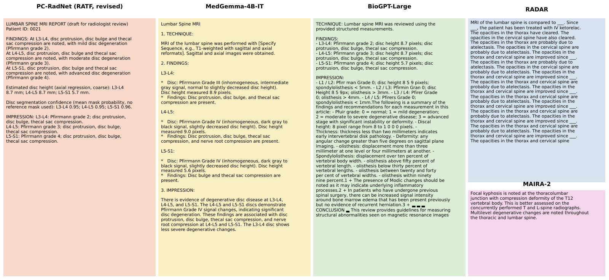

### Cross-dataset transfer

| Dataset | n | Dice, no GT at inference | Dice, GT crop | Clinical output (model / reference) |
|---|---|---|---|---|
| LSMA-PQR | 624 | 0.861 | - | grade exact 61.8% / 50.9% |
| SPIDER | 210 | 0.596 | 0.629 | bulging F1 0.82 / 0.96 (AUC 0.71) |
| RSNA 2024 | 300 levels | - | - | stenosis proxy exact 40.7% / 84.3% |
| SpineWeb | 209 | 0.633 | 0.684 | - |
| SpineParseNet | 633 | 0.398 | 0.375 | - |

- **SPIDER adaptation:** a controlled 30-epoch experiment on the official split (146 / 26 / 38 patients).
- **Joint fine-tuning:** on SPIDER and LSMA-PQR together, it reaches 0.827 Dice on the SPIDER test patients and raises LSMA-PQR sagittal Dice to 0.930.
- **SPIDER-only fine-tuning:** fine-tuning the LSMA-PQR checkpoint on SPIDER alone collapses the unannotated sacrum class (0.906 to 0.091).

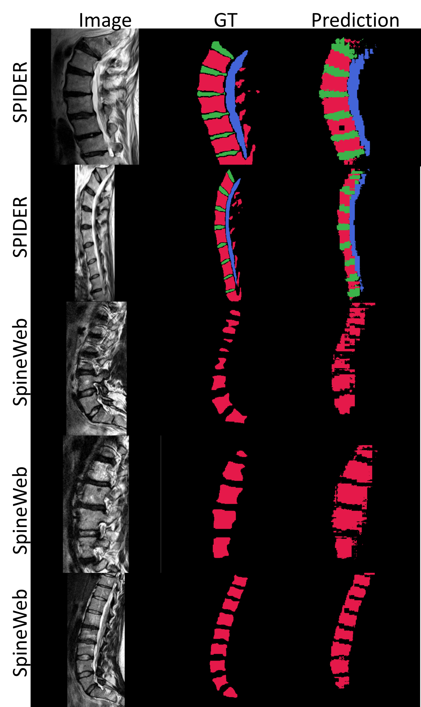

### Qualitative results and gate analysis

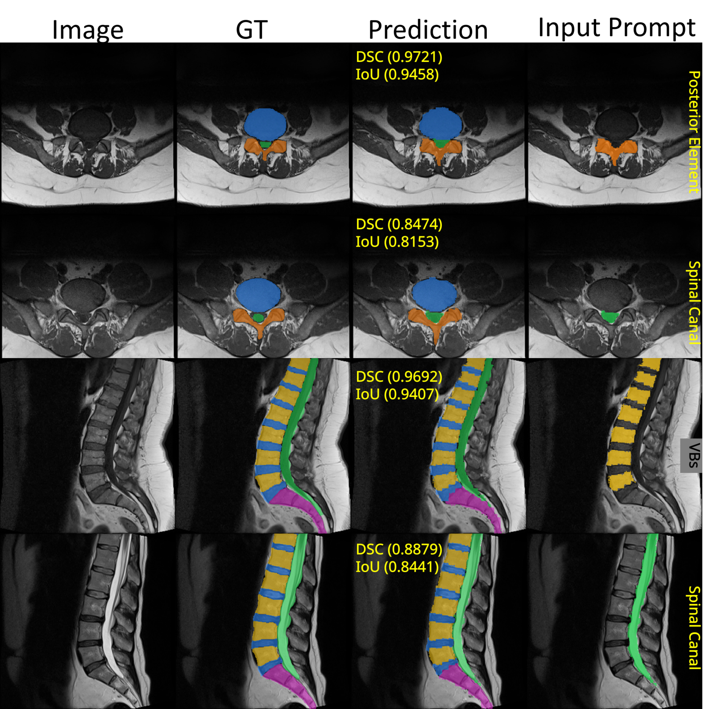

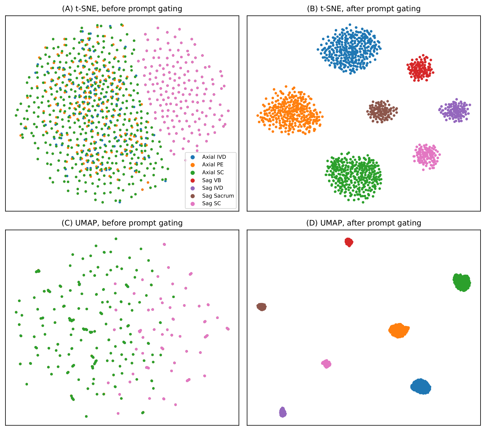

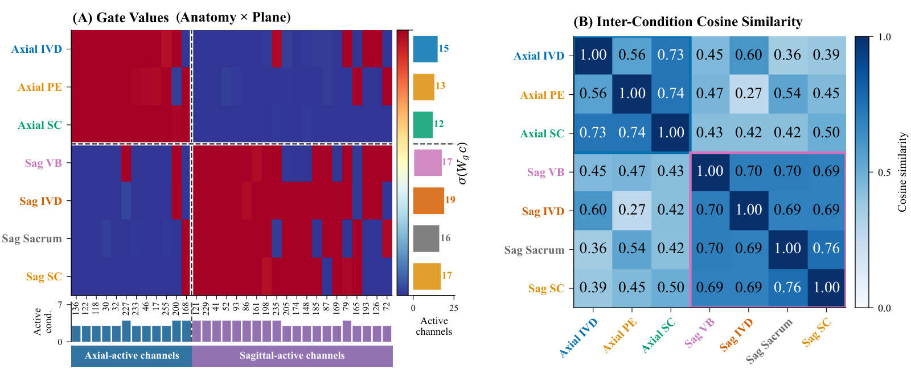

---

## Installation

```bash
git clone https://github.com/farhatmasood/pc-radnet.git
cd pc-radnet
conda env create -f environment.yml
conda activate pc_radnet
```

- **Tested setup:** Python 3.10 and PyTorch 2.5.1 (CUDA 12.1) on a single NVIDIA RTX 4070 Laptop GPU (8 GB).
- **Scope of the environment:** it covers training, evaluation and all analysis scripts.
- **Separate installs:** the report-generation baselines need their model weights from Hugging Face, plus the packages named in the header of each `scripts/benchmark_*.py`. LLaVA-Rad, for example, requires its own repository.

---

## Data and model files

All paths are set in [`configs/config.yaml`](configs/config.yaml). Relative paths resolve against the repository root.

| Item | Default location | Needed for |
|---|---|---|
| LSMA-PQR release | `data/LSMA-PQR/` (`paths.dataset_root`) | everything that reads images |
| Model checkpoints | `checkpoints/best_by_mdice_{A0..A3}.pt` | evaluation of A0 to A3 |
| Variant checkpoints | `checkpoints/variants/{name}_best.pt` | variants in `analysis/` |
| Retrieval index | `checkpoints/faiss_rag_index.bin`, `checkpoints/faiss_metadata.json` | `scripts/generate_report.py --mode rag` (built with `--build-index`); `analysis/ratf_analysis.py` builds its sentence index in memory from the training reports |
| SAM ViT-B weights | `checkpoints/pretrained/sam_vit_b_01ec64.pth` | SAM baselines |
| MedSAM2 repository | `third_party/MedSAM2/` | MedSAM-2 baseline |
| SPIDER, RSNA 2024, SpineWeb, SpineParseNet | `paths.external_datasets` | cross-dataset evaluation |

- **Not in git:** model weights (`*.pt`, about 360 MB each) are not tracked.
- **Data splits:** the split files in `data/` list image file names. `scripts/repo_config.py` maps each name to `paths.images`.

---

## Reproducing the results

Run all commands from the repository root. Each step writes to `results/` (or `results/analysis/`), and those folders already hold the outputs used in the manuscript. Steps marked GPU need the dataset and a CUDA device.

### 1. Main models A0 to A3 (GPU)

```bash
python scripts/train.py --phase 1 --ablation A2     # 5 epochs, lr 1e-4
python scripts/train.py --phase 2 --ablation A2     # up to 50 epochs, lr 5e-5, early stopping (patience 10)
```

- **Other variants:** repeat with `--ablation A0`, `A1` and `A3`.
- **A0:** trains without LoRA.
- **A0 and A1:** keep the calibrator at its random initialization.
- **A3:** sets the boundary-loss weight to 1.0.
- **Seed:** 42 (`configs/config.yaml`).

### 2. Evaluation of A0 to A3 (GPU)

```bash
python scripts/evaluate.py --all-ablations --split test        # results/test_A*_per_image.csv
python scripts/evaluate.py --all-ablations --split val
python analysis/evaluate_unified.py --name A2 --ckpt checkpoints/best_by_mdice_A2.pt --kind orig --save-sag
```

- **Other models:** repeat `evaluate_unified.py` for A0, A1 and A3.
- **What it records:** prompted Dice for every present class, multi-class output selection, and the clinical outputs. Results go to `results/analysis/unified/`.

### 3. Controlled variants (GPU)

```bash
python analysis/train_variant.py --variant noSDA --seed 42 --no-grad-ckpt            # A2-SDA, full schedule
python analysis/train_variant.py --variant A2 --seed 42 --short --no-grad-ckpt       # 15-epoch runs
python analysis/train_variant.py --variant A2 --seed 7 --short --no-grad-ckpt
python analysis/train_variant.py --variant anatOnly --seed 42 --short --no-grad-ckpt
python analysis/train_variant.py --variant simpleEmb --seed 42 --short --no-grad-ckpt
python analysis/train_variant.py --variant segOnly --seed 42 --short --no-grad-ckpt
python analysis/evaluate_unified.py --name noSDA_s42 --ckpt checkpoints/variants/noSDA_s42_best.pt --kind rev --variant noSDA
python analysis/short_runs_table.py                                                  # evaluates the 15-epoch runs, prints table rows
```

`analysis/run_full_variants.sh` and `analysis/run_short_variants.sh` run these jobs in sequence.

### 4. Statistics from stored predictions (CPU)

These scripts read only the CSV files in `results/`. `patient_statistics.py` also reads `IVDHeights.csv` from the dataset for the constant height predictor.

```bash
python analysis/patient_statistics.py A0 A1 A2 A3 noSDA_s42 A2_s42_short A2_s7_short anatOnly_s42_short segOnly_s42_short simpleEmb_s42_short
python analysis/original_clinical_outputs.py     # grading, height, disorders of A0 to A3
python analysis/segmentation_paired_tests.py     # CIs and paired tests for prompted segmentation
python analysis/ablation_table.py
```

### 5. Baselines

```bash
python scripts/evaluate_direct_baselines.py --model all --epochs 30   # GPU: U-Net, SwinUNETR, SAM decoder on the same split
python scripts/baseline_zeroshot.py --split test                     # GPU: SAM ViT-B with ground-truth boxes
python analysis/zero_shot_full_test.py                               # GPU: SAM automatic masks and MedSAM-2 on the full test split
python analysis/zero_shot_summary.py                                 # CPU
python analysis/same_split_summary.py                                # CPU: comparison table with patient-level CIs
```

### 6. Axial canal fine-tune and disorder model (GPU)

```bash
python scripts/sc_finetune_a3.py           # A3 axial canal fine-tune
python scripts/improve_sc_segmentation.py  # axial U-Net reference with the same canal protocol
python scripts/improve_rare_disorders.py   # ResNet-50 with focal loss and oversampling (Enh. F1)
```

### 7. Disc height in the sagittal plane (CPU)

```bash
python analysis/sagittal_height.py A2 test T2   # needs the sagittal masks saved by evaluate_unified.py --save-sag
```

### 8. Report generation

```bash
python analysis/ratf_analysis.py                                      # RATF stages T, R and RC; 20 and 78 patients; unified scoring
python analysis/ratf_benchmark_table.py
python analysis/ratf_bertscore.py                                     # BERTScore with RoBERTa-large
python scripts/evaluate_medcpt_retrieval.py                           # MiniLM vs MedCPT retrieval
python scripts/benchmark_report_llms_v2.py                            # GPU: language-model baselines
```

- **Model-specific baselines:** run the `scripts/benchmark_*.py` scripts (LLaVA-Rad, MAIRA-2, RADAR, Meditron3, Llama-3.2, Med-PaLM) and `scripts/compare_medgemma_reports.py` (MedGemma).
- **Stored outputs:** `results/report_benchmark/reports/` and `results/medgemma_reports/`.

### 9. Cross-dataset evaluation (GPU)

```bash
python scripts/evaluate_external_v2.py --dataset rsna
python analysis/rsna_summary.py
python analysis/external_gt_free.py --dataset spider
python analysis/external_gt_free.py --dataset spider --oracle-crop
python analysis/external_gt_free.py --dataset spineweb
python analysis/external_gt_free.py --dataset spineparsenet
python analysis/spider_adaptation.py --epochs 30
```

### 10. Workflow timing, gate analysis and figures

```bash
python analysis/workflow_analysis.py all         # GPU: review flags and examination-level timing
python analysis/gate_feature_analysis.py         # GPU: gate vectors, t-SNE/UMAP, encoder silhouette
python analysis/fig_training_curves.py           # needs the local W&B run folders; the extracted curves are in results/analysis/training_curves.json
python analysis/fig_short_curves.py
python analysis/fig_height_agreement.py
python analysis/fig_report_comparison.py
```

- **Notebook figures:** the remaining result figures were produced from the files in `results/` with `notebooks/manuscript_figures.ipynb`.
- **Schematics:** Figures 1 to 3 are schematic drawings.

---

## Where each reported number comes from

| Manuscript item | File |
|---|---|
| Ablation table, upper block (segmentation) | `results/analysis/seg_paired_tests.json`, `results/analysis/ablation_rows.json` |
| Ablation table, A0 to A3 clinical columns | `results/analysis/stats_clinical_orig.json` |
| Ablation table, A2-SDA and 15-epoch rows | `results/analysis/stats_core.json`, `results/analysis/ablation_rows.json` |
| Training curves | `results/analysis/training_curves.json`, `results/analysis/train_logs/` |
| Per-class Dice | `results/test_A*_per_image.csv` (columns `dice_<class>`) |
| Axial canal fine-tune, axial U-Net | `results/sc_enhanced_test_metrics.json`, `scripts/sc_finetune_a3.py` output |
| Segmentation comparison | `results/analysis/baselines_same_split.json`, `results/analysis/baselines_full/summary.json`, `results/analysis/workflow_timing.json` |
| Pfirrmann grading | `results/analysis/stats_clinical_orig.json` (A2orig) |
| Disc height (axial and sagittal) | `results/analysis/stats_clinical_orig.json`, `results/analysis/sag_height_A2_test_T2.csv` |
| Disorder table | `results/analysis/disorders_A2orig.csv`, `results/disorder_enhanced_test_metrics.json` |
| Report benchmark | `results/analysis/ratf/bench20_table.csv`, `results/analysis/ratf/bench20_unified_scores.csv`, `results/analysis/ratf/bertscore_bench20.json`, `results/nlg_evaluation_comprehensive_summary.csv` |
| RATF audit on 78 patients | `results/analysis/ratf/ratf_summary.json`, `results/analysis/ratf/audit_test78.csv` |
| Retrieval encoder comparison | `results/retrieval_comparison.json` |
| Examination-level workflow | `results/analysis/workflow_flags.json`, `results/analysis/workflow_timing.json` |
| Cross-dataset table | `results/analysis/external_rev/`, `results/analysis/rsna_recomputed.json` |
| SPIDER adaptation | `results/analysis/spider_adapt/spider_adapt_results.json` |
| Gate and feature-space analysis | `results/analysis/interpretability/gate_feature_A2.json` |

The CPU-only scripts in step 4 and the summary scripts in steps 5 and 9 reproduce the stored JSON files exactly from the CSV files in `results/`.

---

## Repository structure

```
pc-radnet/
├── analysis/                 extended experiments: variants, unified evaluation, statistics,
│                             external and SPIDER experiments, RATF analysis, figures
├── assets/figures/           figures shown in this README (rendered from the manuscript figures)
├── configs/config.yaml       paths, model, training and loss settings
├── data/                     patient-level split files and dataset notes
├── notebooks/                figure notebook
├── results/
│   ├── *.csv, *.json         per-image predictions and summaries written by scripts/
│   ├── analysis/             outputs of analysis/ (unified evaluation, statistics, RATF, external)
│   ├── report_benchmark/     reports and per-patient scores of the language-model baselines
│   ├── medgemma_reports/     MedGemma-4B-IT reports
│   ├── ratf_reports_*/       earlier RATF outputs used as reference rows
│   ├── external_v2/          external evaluation outputs (RSNA, SPIDER, SpineWeb, SpineParseNet)
│   ├── expanded_baselines/   SAM automatic-mask and MedSAM-2 runs
│   └── qualitative/          segmentation overlays
├── scripts/                  model, training, evaluation, baselines, report generation
│   ├── repo_config.py        configuration loading and split-file resolution
│   ├── train.py              PC-RadNet model, dataset and training loop
│   └── ...
├── src/pc_radnet/            package stub; local model weights are kept here and not tracked
├── environment.yml
└── LICENSE
```

---

## Citation

```bibtex
@article{masood2026pcradnet,
  title   = {A Prompt-Calibrated, Parameter-Efficient Framework for Multi-Task Segmentation,
             Clinical Assessment and Report Generation in Lumbar Spine {MRI}},
  author  = {Masood, Rao Farhat and Taj, Imtiaz Ahmad, Muhammad Babar Khan, Muhammad Asad Qureshi},
  year    = {2026},
  note    = {Manuscript under review}
}
```

<!-- Please also cite the LSMA-PQR dataset when using the data. -->

## License

MIT License. See [LICENSE](LICENSE).
